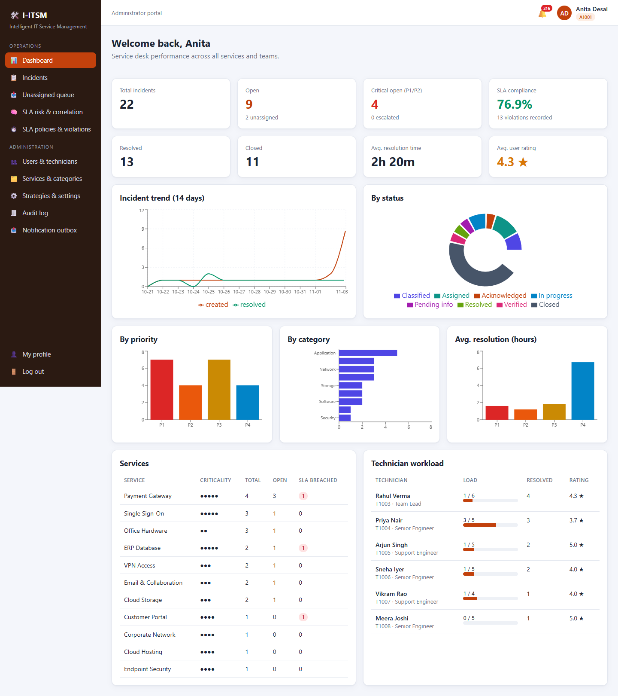

# I-ITSM — Intelligent IT Service Management & Incident Resolution System

CS F213 Object-Oriented Programming project, Semester I 2026-27.

A full-stack web application that manages the complete lifecycle of IT incidents —
**Report → Classify → Prioritise → Assign → Investigate → Resolve → Verify → Close** — with
three role-specific portals (Employee, Support Engineer, Administrator), SLA monitoring,
notifications, a full audit trail and seven intelligent features.



---

## Quick start

Requirements: **JDK 21 or newer** (developed with Temurin JDK 25) and an internet connection for the first build.
You do **not** need to install Maven or Node.js — the Maven Wrapper downloads Maven, and the build downloads its own Node.js.

```powershell
cd backend
.\mvnw.cmd package          # builds React UI + Spring Boot, runs 36 tests  (Linux/macOS: ./mvnw package)
java -jar target\itsm-backend-1.0.0.jar
```

Open **http://localhost:8080** and click one of the demo accounts on the login page.

| Username | Password | Role |
|---|---|---|
| `amit`, `neha`, `karan`, `isha` | `pass123` | Employee |
| `rahul` | `pass123` | Technician — Team Lead |
| `priya`, `arjun`, `sneha`, `vikram`, `meera` | `pass123` | Technician |
| `admin` | `admin123` | Administrator — IT Manager |
| `sysadmin` | `pass123` | Administrator — System Administrator |

The first start creates an H2 database in `backend/data/` and seeds services, categories, SLA policies, users
and ~20 realistic incidents (including a payment-gateway outage burst for the duplicate/correlation demo).
Delete `backend/data/` to start again from fresh demo data.

### Development mode (hot reload)

```powershell
# terminal 1 – API on :8080 (skip rebuilding the UI)
cd backend;  .\mvnw.cmd spring-boot:run -DskipFrontend=true
# terminal 2 – React dev server on :5173 (proxies /api to :8080)
cd frontend; $env:PATH = "$PWD\node;$env:PATH"; npm run dev
```

### Optional: real e-mail through Gmail

E-mail notifications are simulated unless SMTP credentials are provided. To send real e-mail, create a Gmail account
for the project, turn on 2-Step Verification, create an **App Password** at
[myaccount.google.com/apppasswords](https://myaccount.google.com/apppasswords), then start the app with:

```powershell
cd backend
powershell -ExecutionPolicy Bypass -File .\run-with-email.ps1 -GmailAddress you@gmail.com -RedirectTo you@gmail.com
```

The script asks for the App Password (hidden input) and keeps it only in memory. Credentials are read from the
`ITSM_MAIL_USERNAME` / `ITSM_MAIL_PASSWORD` environment variables and are never stored in the code or the repository.
Seeded demo users have `@itsm.local` addresses, which are skipped; `-RedirectTo` sends every notification to one inbox
(the original recipient is shown in the subject). Mail is sent on a background thread, so a slow SMTP server never
delays an incident operation. Administrators can check the channel with *Strategies & settings → Send a test e-mail*.

### Optional: LLM-assisted categorisation

Set `ITSM_AI_API_KEY` (and optionally `ITSM_AI_BASE_URL`, `ITSM_AI_MODEL`) to any OpenAI-compatible API.
Without a key the built-in keyword + history classifier is used, so the app works fully offline.

---

## Technology stack

| Layer | Technology | Why |
|---|---|---|
| Language | Java 21 | Strong static typing, records, sealed/pattern-matching features, the course language |
| Backend | Spring Boot 3.5 (Web, Data JPA, Validation, Scheduling) | Dependency injection keeps classes small and testable; industry standard |
| Persistence | H2 (file mode) via JPA/Hibernate | Zero-install relational DB; switching to PostgreSQL/MySQL is a config change |
| Security | BCrypt password hashing, JWT (jjwt), role-based interceptor | Stateless API authentication with role checks on every endpoint |
| Frontend | React 18 + Vite 5, React Router, Recharts | Component model, fast builds, charts for dashboards |
| Build | Maven Wrapper + frontend-maven-plugin | One command builds UI + API into one runnable jar |
| Testing | JUnit 5, Spring MockMvc, Playwright (UI) | Unit, integration and end-to-end browser tests |

---

## Requirement coverage

| Requirement (MVP) | Where |
|---|---|
| 3 user types (Employee, Technician, Administrator) with different GUIs | `domain/user`, `frontend/src/components/Layout.jsx` (role menus + colour themes) |
| Incident create / view / update / assign / resolve / close | `IncidentService`, `IncidentController`, `pages/IncidentDetail.jsx` |
| Priority from impact, urgency, business criticality (+ affected users) | `strategy/priority` — 2 strategies, switchable at runtime |
| ≥ 2 assignment strategies | `strategy/assignment` — skill, load, round-robin, smart (4) |
| SLA calculation, deadline tracking, warnings, violation detection | `SlaService`, `SlaMonitorService` (`@Scheduled` every 30 s) |
| ≥ 2 notification mechanisms | In-app, e-mail (real Gmail SMTP or simulated), SMS (third-party API via Adapter) |
| Complete audit history | `AuditTrailListener`, `/api/audit`, incident timeline |
| ≥ 5 search criteria | ID, keyword, status, priority, category, service, technician, SLA status, date range, open/unassigned |
| ≥ 2 intelligent features | 7 — see below |
| Persistence | H2 database through Spring Data repositories |

### Intelligent features

1. **Automatic categorisation** — ensemble of keyword matching (50 %), k-nearest-neighbour on past incidents (25 %) and the service's usual category (25 %); optional LLM.
2. **Duplicate detection** — TF cosine similarity with synonyms + stemming, boosted for the same service; warns while the employee types.
3. **Incident correlation / major-incident detection** — groups open incidents by service and category in a time window.
4. **Automatic escalation** — P1–P2 incidents not acknowledged within the response target escalate one level per missed window: Technician → Team Lead → System Administrator → IT Manager.
5. **Smart technician recommendation** — multi-factor score (skill, spare capacity, experience, service history, seniority) with reasons.
6. **SLA risk prediction** — compares remaining time with expected effort learned from historical resolution times.
7. **Suggested resolutions** — resolutions of the most similar solved incidents, ranked by similarity and user rating.

Plus: auto-close of unverified resolved incidents after 72 h, and user feedback ratings.

---

## Object-oriented design

| Concept / pattern | Example in code |
|---|---|
| **State** | `domain/incident/state/*` — each lifecycle status is a class that allows only legal actions; `NEW → CLOSED` throws `InvalidStateTransitionException` |
| **Strategy** | `PriorityStrategy` (matrix, weighted) and `AssignmentStrategy` (skill, load, round-robin, smart), held in a generic `StrategyRegistry<T>` |
| **Observer** | `IncidentEventPublisher` → `AuditTrailListener`, `NotificationListener` |
| **Factory** | `UserFactory` (Employee/Technician/Administrator), `NotificationSenderFactory` |
| **Adapter** | `ThirdPartySmsAdapter` wraps a vendor SMS client; `LlmCategoryClassifier` wraps an OpenAI-compatible API |
| **Template Method** | `AbstractNotificationSender.send()` — fixed algorithm, channel-specific `deliver()` |
| **Repository** | Spring Data repositories in `repository/` |
| **Facade** | `IntelligenceService` hides the five intelligence components |
| **Flyweight** | `IncidentStates` shares one stateless instance per status |
| Inheritance | `User` ← `Employee`, `Technician`, `Administrator` (JPA single-table) |
| Composition | `Incident` owns its `IncidentNote`s (cascade + orphan removal) |
| Aggregation / association | `Technician` ↔ skill `Category`s; `Incident` → `ItService`, reporter, technician |
| Encapsulation | Entities expose intention-revealing methods (`incident.resolve(...)`) instead of public setters |
| Exceptions | `ItsmException` hierarchy (11 types) mapped to HTTP codes by `GlobalExceptionHandler` |

---

## Project structure

```
backend/                      Spring Boot application (Java)
  src/main/java/com/itsm/
    domain/                   entities, enums, incident state machine
    strategy/                 priority & assignment strategies
    event/                    observer: publisher + listeners
    notification/             senders, factory, SMS adapter
    intelligence/             classifier, duplicates, correlation, SLA risk, resolutions
    service/                  business logic / use cases
    security/                 password hashing, JWT, role interceptor
    web/                      REST controllers, DTOs, error handling
    config/                   web config, demo data seeder
  src/test/java/              36 automated tests (TC01–TC32)
frontend/                     React single-page app
  src/pages/                  role pages (employee, technician, admin)
  src/components/             layout, tables, badges
  e2e/                        Playwright browser tests
docs/                         screenshots and learning guide
```

---

## Testing

```powershell
cd backend;  .\mvnw.cmd test -DskipFrontend=true      # 36 unit + integration tests
cd frontend; $env:PATH = "$PWD\node;$env:PATH"
npm run e2e              # every page for every role renders without errors (server must be running)
npm run e2e:lifecycle    # report -> assign -> acknowledge -> start -> resolve -> verify -> feedback in the browser
```

| ID | Test case | Type |
|---|---|---|
| TC01 | Payment outage (high impact, critical urgency, criticality 5) is P1 | Normal |
| TC02 | Single-user low-urgency problem on a minor service is P4 | Normal |
| TC03 | Priority boundary scores map to the correct band (parameterised) | Boundary |
| TC04 | Weighted strategy raises priority when many users are affected | Business rule |
| TC05 | Full lifecycle NEW → … → CLOSED succeeds and records timestamps | Normal |
| TC06 | NEW → CLOSED is rejected | Invalid transition |
| TC07 | Technician cannot resolve before acknowledging and starting work | Invalid transition |
| TC08 | Pending-info round trip and reopen after resolution | Business rule |
| TC09 | Closed incidents allow no further actions | Exception |
| TC10 | Each state exposes only its legal actions | Business rule |
| TC11 | Feedback rating outside 1..5 is rejected | Invalid input |
| TC12 | Skill-based strategy picks the technician skilled in the category | Normal |
| TC13 | Load-based strategy picks the least busy technician | Normal |
| TC14 | Round robin rotates through technicians | Normal |
| TC15 | Smart strategy balances skill, workload, experience and explains its choice | Business rule |
| TC16 | No candidates → no selection (TechnicianUnavailable) | Exception |
| TC17 | Text analyser folds synonyms and stems words | Normal |
| TC18 | Locked account is classified as Authentication | Intelligent |
| TC19 | Outlook crash → Software; Teams audio drop is not Network-only | Intelligent |
| TC20 | Duplicate detector links the three payment reports, ignores unrelated ones | Intelligent |
| TC21 | Suggested resolution comes from the most similar solved incident | Intelligent |
| TC22 | SLA risk: overdue incident scores 100, fresh low-priority incident scores low | Intelligent |
| TC23 | Three open incidents on one service → suspected major incident | Intelligent |
| TC24 | SMS adapter converts local numbers to the vendor's international format | Adapter |
| TC25 | Invalid login → 401 INVALID_LOGIN | Security |
| TC26 | No token → 401; employee on admin endpoint → 403 | Authorization |
| TC27 | Invalid incident input → 400 with field errors | Invalid input |
| TC28 | Workflow: report → auto classify → P1 → SLA → assigned → audited & notified | Integration |
| TC29 | Invalid transition via API → 409; duplicate re-submission blocked | Exception |
| TC30 | Employees cannot see incidents reported by someone else | Authorization |
| TC31 | SMTP e-mail: real addresses sent, demo addresses skipped, redirect applied, SMTP failure doesn't break the operation | External service |
| TC32 | Scheduled SLA monitor saves its results: an overdue incident's violation is reported once, not on every run | Regression |

---

## Demo workflows (for the video)

1. **Employee reports → system prioritises → technician assigned → notified** — log in as `amit`, *Report an incident*
   on *Payment Gateway*; watch the live category suggestion and duplicate warning; open the incident to see P1,
   the SLA clock, the smart assignment and the audit trail. Check the bell icon / *Notification outbox* as `admin`.
2. **Technician investigates → SLA monitored → resolved → user notified** — log in as the assigned technician,
   *Acknowledge*, *Start work*, add an internal note, *Resolve*; then as the employee *Confirm it is fixed* and rate it.
3. **Duplicates / correlation / escalation** — as `rahul` open *SLA risk & correlation*: the three payment incidents
   are flagged as a suspected major incident; as `admin` click *Run SLA monitor now* on the SLA page to see violations
   and escalations appear in the audit log.

## Security notes

Passwords are stored as BCrypt hashes; the API is stateless with signed JWTs (8 h expiry); every endpoint is checked
by `AuthInterceptor` + `@RequiresRole`; employees only see their own incidents and never see internal notes;
all input is validated with Bean Validation; errors never expose stack traces. For production, set
`ITSM_JWT_SECRET`, serve over HTTPS and switch to a server database.

## API overview

| Method & path | Purpose |
|---|---|
| `POST /api/auth/login`, `/register`; `GET /api/auth/me` | Authentication |
| `GET/POST /api/incidents` | Search (10 filters) / report |
| `POST /api/incidents/{id}/assign · take · acknowledge · start · notes · request-info · provide-info · resolve · verify · reopen · close · duplicate · feedback · reprioritise · recategorise` | Lifecycle |
| `GET /api/incidents/{id}/recommendations · suggested-resolutions · duplicates` | Intelligence per incident |
| `POST /api/intelligence/classify · duplicates`; `GET /correlations · sla-risks` | Intelligence |
| `GET/POST/PUT /api/users · categories · services · sla/policies · settings` | Administration |
| `GET /api/reports/overview · workload`, `/api/audit`, `/api/sla/violations`, `/api/notifications` | Reporting |
